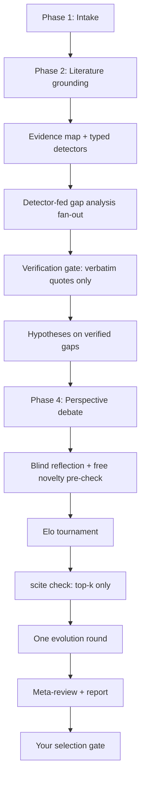

# Gap Discovery Workflow

**Protocol file:** `src/scieflow/research/skills/gap-discovery/SKILL.md` (the coordinator reads this).

A five-phase pipeline that answers *"what does the field not know yet — and
what could I discover with what I have?"*, built Robin / Co-Scientist style:
core fetches typed evidence, agents find gaps in it, a mechanical gate drops
every gap without a verbatim quote, and the surviving hypotheses compete in
a tournament before you choose. Agents ground their analysis in a literature
search, optional free discovery providers and scite, your draft article
(optional) and your [data package](../data-packages.md) (optional). The
result is a gap report with tournament-ranked, testable hypotheses, each
carrying an experiment design, a novelty check and a full evidence trail.

## Phase overview



| Phase | Who | Output |
| --- | --- | --- |
| 1. Intake | Coordinator (+ you) | `inputs/` data package, `brief.md`, `status.yml` |
| 2. Literature | All agents (fan-out) | `findings/<agent>.json` — or reused from a lit-review run |
| 3. Gap analysis | Core, then agents, then core | `discovery/evidence/`, `gaps/<agent>.json`, `discovery/verified.json`, `discovery/hypotheses.json` |
| 4. Debate | All agents + coordinator | `debate/round-N/<agent>.md`, adjudications |
| 5. Synthesize | Agents (critique, judging, evolution), core, coordinator | `discovery/round-N/`, `report/gaps.md`, `report/meta-review.md`, `report/tournament.{json,md}`, `report/selected_hypotheses.json` |

## Phase 1 — Intake

The coordinator builds your data package: your result files go to
`inputs/results/`, your processing description to `inputs/processing.md`,
optional scripts and draft article alongside. It interviews you about
anything it can't infer — what each artifact is and how it was produced —
and writes the validated `inputs/manifest.yml` that gives each artifact a
citable id like `[data:tbl-metrics]`. No data? The run proceeds on
literature + article alone and says so in the report. It also asks the scite
question (the run's `review.scite`, see [scite](../scite.md)).

## Phase 2 — Literature grounding

The same search fan-out as the [literature review](lit-review.md) (same
shared search scripts, same schema validation) but without cross-review —
this is grounding, not a full review. If you already ran a lit-review on
the topic, set `literature_from:` in the workspace `config.yml` and this
phase reuses those findings instead of searching again.

## Phase 3 — Gap analysis

1. **Evidence map.** With you, the coordinator writes
   `discovery/query.yml` — general topic words, a few seed DOIs, optionally a
   PubTator entity, a ClinicalTrials.gov condition, trend terms and two
   fields to bridge. Nothing from your data may appear there; the command
   refuses numbers, cohort descriptors, `[data:…]` labels and paths.
   `scieflow research scite gaps <slug> --plan` shows the exact outgoing
   list (sends nothing); you approve it in an `external-sharing` gate.
2. **Typed detectors.** `scieflow research scite gaps <slug>` makes at most
   two scite MCP calls — contrasting citation statements on the seeds
   (*disputes*) and sentences stating open questions (*open questions*) — and
   runs the free [discovery providers](../discovery-providers.md) you enabled:
   PubTator3 A→B→C open links, completed-but-unpublished trials, OpenAlex
   trend breaks and bridges. Each detector writes candidate gaps with quotes.
3. **Detector-fed gap analysis.** Each gap-analysis agent gets one or more
   detectors' evidence (one gets your own data and article) and writes up to
   `max_gaps` gaps, each evidence item quoting the fetched text verbatim.
4. **Verification gate.** `scieflow research discover verify` keeps a gap
   only if a quote is found verbatim in what was actually fetched or
   delivered — invented quotes fall out mechanically.
5. **Hypotheses** are written on the verified gaps only (up to
   `max_hypotheses` per agent, each with a testable prediction, confidence
   and an experiment design), then pooled as H1..Hn with their author and
   model family.

## Phase 4 — Perspective debate

Agents challenge each other: alternative framings of the problem,
reinterpretations of your data, attacks and defenses of the proposed gaps
and hypotheses — following the [perspective debate](../debate.md) protocol.
A "this is invalid" claim never silently kills an item; unresolved
disagreements ship as recorded dissent. The adjudication is recorded per
hypothesis (consensus, disputed, challenged, withdrawn, …).

## Phase 5 — Synthesize

1. **Reflection.** A blind critique by each debate agent, then every
   hypothesis is *abstracted* (numbers, cohort descriptors, effect sizes
   removed; anything still looking like data is refused) and pre-checked for
   novelty in OpenAlex and Europe PMC (free, if enabled).
2. **Tournament.** Pairwise comparisons, judged by agents of a model family
   other than both authors where possible, rated with Elo (seeded,
   `max_tournament_comparisons` 28 by default; debate status breaks ties).
3. **scite check.** Only the top `tournament_top_k` (8) — one OR-batched
   novelty search plus, if anything matched, one citation-graph call for
   counter-evidence: at most two MCP calls.
4. **Evolution.** The authors refine their top-k hypotheses once
   (`evolution_rounds: 1`) against the critiques and counter-evidence; only
   changed items are re-checked, and the top-k is re-ranked.
5. **Meta-review and report.** The coordinator writes
   `report/meta-review.md` (patterns across all critiques) and
   `report/gaps.md` with problem framings, verified gaps, ranked hypotheses,
   the tournament table, the meta-review and recorded dissent — plus
   `report/hypotheses.json` and `report/selected_dois.txt`.
   `scieflow research discover check` refuses a report without the current
   tournament table or the meta-review.
6. **Your decision.** A `hypothesis-selection` gate (only you can answer it)
   asks which hypotheses to carry into [paper-draft](paper-draft.md) via
   `gaps_from:`; the answer lands in `report/selected_hypotheses.json`.

**scite budget.** A gap run uses at most **5** scite MCP calls, enforced in
code: 2 for the evidence map, up to 2 for the top-k check, and what is left
for the evolution round's re-check. A spent budget or quota marks the rows
`quota`; the run completes without them. With `review.scite: off` no scite
call is made and the scite detectors report `off`.

| Setting (`config.yml`) | Default | Meaning |
| --- | --- | --- |
| `max_gaps` | 10 | gaps per agent |
| `max_hypotheses` | 5 | hypotheses per agent |
| `evolution_rounds` | 1 | refinement rounds of the top-k |
| `tournament_top_k` | 8 | hypotheses that reach the scite check |
| `max_tournament_comparisons` | 28 | pairwise judgements per tournament round |
| `tournament_seed` | from the slug | fixes the schedule and presentation order |

PaperQA2-style local deep reading and Edison / FutureHouse (paid) are named
extension points, not built.

## How to run it properly

- **Use all three agents.** Gap finding lives off independent viewpoints;
  two is the bare minimum for debate quorum, three is meaningfully better.
- **Reuse a lit-review** via `literature_from:` when you have one — cheaper,
  and peer-reviewed selections beat freshly-searched ones.
- **Deliver processed summary artifacts**, not raw dumps — see
  [data packages](../data-packages.md). Agents quote your files; they don't
  recompute them.
- **Read `## Recorded dissent` first.** The items the agents couldn't agree
  on are usually the most interesting ones.
- **Chain forward:** a good gap report is the ideal input for
  [paper-draft](paper-draft.md) via `gaps_from:`.

## Example

You have processed results in `~/study/out/` and want to know what's novel:

> "Find research gaps for <topic>. My results are in ~/study/out/:
> metrics.csv is per-model accuracy, produced by analyze.py which I'm
> including. Use all agents."

The coordinator builds the package and confirms the manifest with you:

```yaml
artifacts:
  - id: tbl-metrics
    file: results/metrics.csv
    kind: table
    description: per-model accuracy, 5-fold CV
    produced_by: scripts/analyze.py
```

then searches, maps the evidence, fans out gap analysis, verifies, debates,
runs the tournament and reports:

```text
workspace/2026-07-<topic>/report/gaps.md                 ← read this
workspace/2026-07-<topic>/report/meta-review.md
workspace/2026-07-<topic>/report/tournament.md
workspace/2026-07-<topic>/report/hypotheses.json         ← feeds paper-draft
workspace/2026-07-<topic>/report/selected_hypotheses.json  ← your pick
workspace/2026-07-<topic>/report/selected_dois.txt
```

Follow-ups: "export the cited papers to Zotero" or "draft a paper from
hypothesis H2" (starts paper-draft with `gaps_from:` set).
